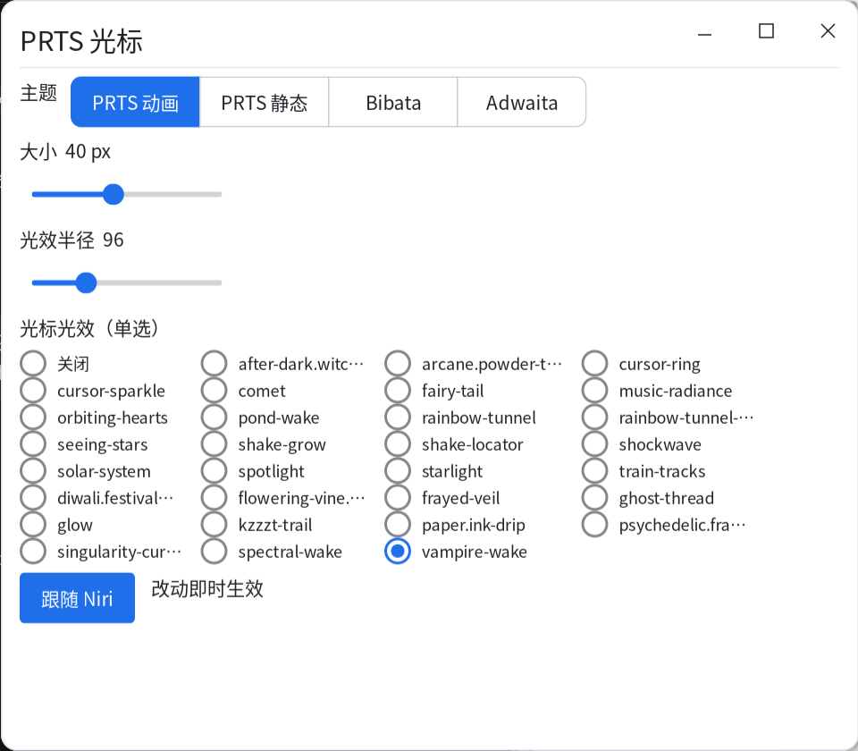

# PRTS 光标

给 Umbriel 用的鼠标主题 / 光标光效切换工具，**HuxerUI** 写的，带托盘，窗口默认浮动。



默认窗口 640×560（正好是内容尺寸），固定四列布局；最小尺寸同为 640×560，可自由拉大。

## 关于 PRTS 主题

本仓库和发布包**不包含** PRTS 鼠标主题本身，只包含切换器。原因：

- 主题包（`PRTS-Final`）有 697 MB / 4338 个文件（4128 个 SVG 帧，104 个光标 × 432 帧），`PRTS-Final-Static` 也有 19 MB
- 其 `Credits.txt` 写明是「非官方自用衍生主题，明日方舟图像与角色版权归原权利人」，重新分发有版权风险

用法是：先自行获取 PRTS 主题包并运行它的 `INSTALL.sh`（装到 `~/.local/share/icons/PRTS-Final*`），再打开本工具切换。没有安装主题时，列表里的 PRTS 选项不会生效。

## 功能

- 切换 Xcursor 主题（PRTS 动画 / PRTS 静态 / Bibata / Adwaita）
- 光标大小 16–72 px
- 切换社区光标 shader 光效，30 个预设单选（glow、cursor.spotlight、vampire-wake…）
- 调整当前光效的半径
- **改动即时生效**：拖完滑条、点完单选就写入 `~/.config/umbriel/config.toml` 并热重载，没有「应用」按钮
- 托盘：显示 / 隐藏窗口、跟随 Niri、退出
- 自绘标题栏，窗口按钮在右侧；「跟随 Niri」一键回到 Bibata 24 + 无光效
- 默认浮动窗口（Umbriel 窗口规则匹配标题 `^PRTS 光标$`）

## 依赖

- [HuxerUI](https://github.com/HuxerUI/HuxerUI) SDK 0.5.5+（`~/.local/share/HuxerUI`）
- Qt6 / GTK 基础库、CMake、Ninja
- Python 3（`helper.py` 读写 Umbriel 配置）
- Umbriel（配置在 `~/.config/umbriel/`）

## 分发包

x86_64 的 RPM / DEB / AppImage 见 [Releases](https://github.com/h465855hgg/prts-cursor/releases)。

```sh
# RPM（Fedora）
sudo dnf install ./prts-cursor-1.0.0-1.fc45.x86_64.rpm
# DEB（Debian/Ubuntu）
sudo apt install ./prts-cursor_1.0.0-1_amd64.deb
# AppImage
chmod +x prts-cursor-1.0.0-x86_64.AppImage && ./prts-cursor-1.0.0-x86_64.AppImage
```

自己打包、以及 aarch64 原生构建说明见 [packaging/README.md](packaging/README.md)。

## 构建与安装

```sh
./install.sh
```

脚本会调用 `huxerui build linux --config release`，然后把二进制、资源目录、图标和 helper 安装到 `~/.local/opt/prts-cursor`，并写入桌面项。

手动安装：

```sh
huxerui build linux --config release
install -Dm755 .huxerui/build/*/linux/release/prts_cursor_hui ~/.local/opt/prts-cursor/prts-cursor
cp -r .huxerui/build/*/linux/release/prts_cursor_hui.resources ~/.local/opt/prts-cursor/prts-cursor.resources
install -Dm644 helper.py icon.png ~/.local/opt/prts-cursor/
```

> HuxerUI 的可执行文件旁边必须有同名的 `.resources` 目录，重命名二进制时资源目录也要一起改名。

## 工作原理

- `src/app.cpp`：HuxerUI 界面（FlatTheme），滑条 `OnCommitted`、单选/主题 `OnChanged` 时直接调用 helper
- `helper.py`：按段修改 `~/.config/umbriel/config.toml`（`[input.cursor]`、`[effects]`）、改当前光效的 `effect.toml` 半径，然后 `umbriel config validate` → `umbriel msg config-reload` → `umbriel msg effect-cursor-set`
- 托盘用 HuxerUI 内置 `SystemTray`（`ApplicationHook` 里 `tray.Show()` + `OnActivate`）

## 已知限制

- Umbriel 的合成器主题光标不支持多帧 Xcursor 动画，PRTS 动画版在 Umbriel 里是静态的（上游 issue：[noctalia-dev/umbriel#903](https://github.com/noctalia-dev/umbriel/issues/903)）
- 光效不能叠加，同一时间只能挂一个
- 光效需要先安装社区 shader 到 `~/.config/umbriel/shaders/community/cursor/`，并在配置 `[include]` 里引用

## 许可

MIT
