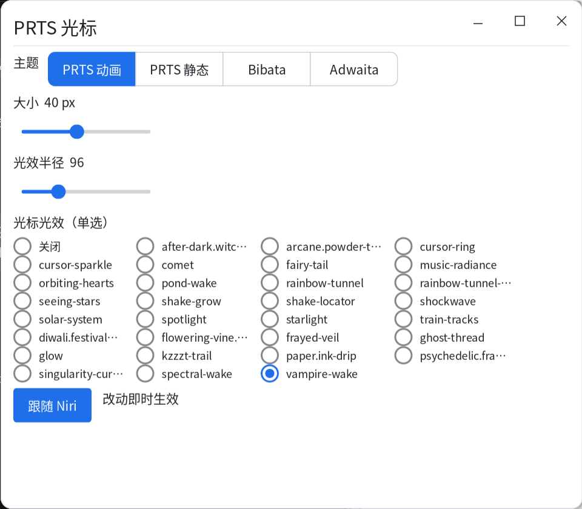

# PRTS 光标

[English](README.md) | [简体中文](README.zh-CN.md)

给 [Umbriel](https://github.com/noctalia-dev/umbriel) 用的光标主题与 shader 光效切换器，[HuxerUI](https://github.com/HuxerUI/HuxerUI) 编写，内置来自 [crowninggg/prts-cursor](https://github.com/crowninggg/prts-cursor) 的 PRTS 光标主题。



## 功能

- 内置主题：`PRTS-Final`（动画，解压约 697 MB / 压缩约 100 MB）和 `PRTS-Final-Static`
- 切换 Xcursor 主题（PRTS 动画 / PRTS 静态 / Bibata / Adwaita）与大小（16–72 px）
- 自动发现社区光标 shader 光效；新装的效果选中后自动加进 Umbriel 的 `[include]`
- 改动即时生效，没有「应用」按钮
- 托盘：显示 / 隐藏窗口、恢复 Niri 默认、退出
- 浮动窗口 + 自绘标题栏

## 分发包

RPM / DEB / AppImage / tar.zst 在 [Releases](https://github.com/h465855hgg/prts-cursor/releases)，都含两套 PRTS 主题。

```sh
sudo dnf install ./prts-cursor-1.2.0-1.fc45.x86_64.rpm
sudo apt install ./prts-cursor_1.2.0-1_amd64.deb
chmod +x prts-cursor-1.2.0-x86_64.AppImage && ./prts-cursor-1.2.0-x86_64.AppImage
```

## 说明

- 主题是明日方舟的二创素材，版权归原权利人；是否分发由使用者自行判断
- 光效单选，Umbriel 同一时间只能挂一个
- 不绑定主题的通用版本在 [umbriel-cursor-switcher](https://github.com/h465855hgg/umbriel-cursor-switcher)

## 许可

MIT（仅应用程序；内置主题保留其自身署名）
